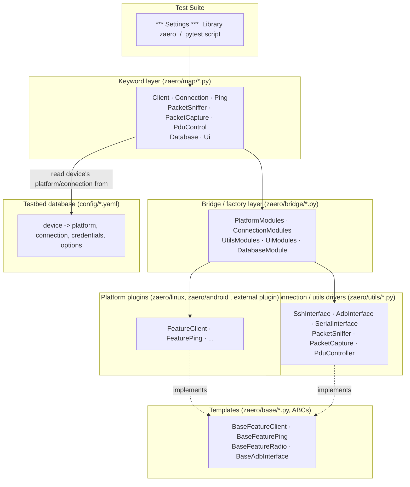

# Architecture

## Overview

Zaero is built as five layers, each depending only on the layer below it.
Test suites (Robot Framework `.robot` files, or plain Python/pytest code)
only ever talk to the top layer — the **keyword layer** — never to a
platform or connection class directly.



## The layers

### 1. Testbed database (`zaero/config/*.yaml`, `zaero/utils/database.py`)

Every keyword takes a `device` name (e.g. `controller`, `controller_wlan_client_1`, `extender` , `extender_wlan_client1`)
rather than an object. `Initialize Database` reads every `.yaml`/`.json`
file in a config directory and merges them into one in-memory dictionary,
keyed by device name. A device entry looks like:

```yaml
controller:
    device_present: True                 # Indicates whether the controller device is present in the testbed
    platform: 'rdkbmeshzap'              # Zaero plugin name used for the controller
    connection: 'ssh'                    # Connection method used to access the controller
    ssh_tunnel: False                    # Indicates whether SSH tunneling is required
    wan_iface: 'erouter0'                # WAN interface name of the controller
    login_ip: '172.16.130.159'            # IP address used to connect to the controller
    username: 'root'                     # SSH login username
    password: 'user'                     # SSH login password
    port: 22                             # SSH port number
    serial_port: '/dev/ttyUSB0'          # Serial device port used to access the controller
    serial_baudrate: 115200              # Baud rate used for the serial connection
    pcap_remote_dir: /home/root/pcap_logs # Directory on the controller where packet captures are stored
    pcap_local_dir: /home/sujitha/pcap_logs # Local directory where packet captures are copied
```

`platform` and `connection` are the two fields the rest of the framework
dispatches on.

### 2. Templates — `zaero/base/*.py`

Python ABCs that describe the methods a platform (or, for
`BaseAdbInterface`, a connection driver) must provide:

- `BaseFeatureClient` — client Wi-Fi operations (`get_client_ipv4`,
  `connect_client_to_ssid`, `get_client_rssi`, ...).
- `BaseFeaturePing` — `ping_ipv4` / `ping_ipv6`.
- `BaseFeatureRadio` — radio/channel/bandwidth/tx-power configuration.
- `BaseAdbInterface` — the ADB transport contract.

Keyword modules and factories only ever type-reference these ABCs
conceptually — they never import a concrete platform class directly.

### 3. Platform plugins — `zaero/linux/`, `zaero/android/`, out-of-tree packages

A platform plugin implements one or more `base_feature_*` ABCs for a real
OS. For example `zaero/linux/feature_client.py` implements
`BaseFeatureClient` using `nmcli`/`iw`/`ifconfig`, while
`zaero/android/feature_client.py` implements the same contract using
`adb shell` + `wpa_cli`/`dumpsys`.

A plugin package must expose, at its top level, a class whose name is
**identical to the package name**:

```python
# zaero/linux/__init__.py
class linux(FeatureClient, FeaturePing):
    def __init__(self):
        FeatureClient.__init__(self)
        FeaturePing.__init__(self)
```

```python
# zaero/android/__init__.py
class android(FeatureClient):
    def __init__(self):
        FeatureClient.__init__(self)
```

This naming convention is what lets the framework discover a platform
purely from the string stored in the testbed database (`platform: 'linux'`)
— see the bridge layer below.

### 4. Bridge / factory layer — `zaero/bridge/*.py`

Four small singleton factories decouple the keyword layer from concrete
implementations, importing them lazily by name and caching one instance per
name:

| Factory | Resolves | Backed by |
|---|---|---|
| `PlatformModules.get_platform_module_object(name)` | `platform` field | `importlib.import_module("zaero." + name)`, looks for a class named `name` |
| `ConnectionModules.get_connection_module_object(name)` | `connection` field | static map `{'ssh': SshInterface, 'adb': AdbInterface, 'serial': SerialInterface}` |
| `UtilsModules.get_utils_module_object(name)` | fixed keys (`sniffer`, `capture`, `pdu`) | static map to the matching `zaero/utils/*.py` class |
| `UiModules.get_ui_module_object(name)` | `platform` field | `importlib.import_module(name + ".feature_ui")`, looks for class `FeatureUi` |
| `DatabaseModule.get_database_module_object()` | — | the single shared `Database` instance |

`PlatformModules` is how a keyword like `Get Client Ipv4` ends up calling
the right OS-specific code without an `if platform == "linux"` anywhere in
the keyword layer:

```python
# zaero/map/client.py — Client.get_client_ipv4()
platform = self.db_obj.read_from_database(device, 'platform')
platform_obj = self.get_platform_module_object(platform)
return platform_obj.get_client_ipv4(device)
```

### 5. Keyword layer — `zaero/map/*.py`

Robot Framework libraries (`ROBOT_AUTO_KEYWORDS = False`, methods decorated
with `@keyword("...")`) that are the only thing a test suite ever calls.
Each keyword: reads `platform`/`connection` for the given `device` from the
database, fetches the matching object from the bridge layer, and delegates.
These are feature-oriented, vendor-agnostic entry points:

- `Client` — client-side Wi-Fi operations.
- `Connection` — connect/execute/get-file/put-file against any device.
- `Ping` — reachability.
- `PacketSniffer`, `PacketCapture` — monitor-mode capture/sniffing and
  `.pcap` retrieval.
- `PduControl` — power-cycling devices through a PDU.
- `Database` — direct access to `Initialize/Read/Write Into Database`.
- `Ui` — Playwright-driven browser automation of a device's web GUI.

`zaero/__init__.py` combines every one of these into a single class:

```python
class zaero(Client, Connection, Database, Ping, Ui,
            PacketSniffer, PacketCapture, platform, PduControl):
    ...
```

so a suite only ever needs `Library    zaero` to get every keyword.

### 6. Connection / utils drivers — `zaero/utils/*.py`

Low-level, transport-specific code that platform plugins and keyword
modules call into:

- `SshInterface` — Paramiko-based SSH, including **multi-hop tunnelling**
  (a device with `ssh_tunnel: True` and `tunnel_device: controller` is
  reached by opening a `direct-tcpip` channel through the already-connected
  tunnel device's transport) and password-less (`auth_none`) login for
  devices like prplOS/dropbear that have no password set.
- `AdbInterface` — wraps `adb` for Android devices.
- `SerialInterface` — serial console access.
- `PacketSniffer` / `PacketCapture` — monitor-mode and normal-mode capture.
- `PduController` — serial-driven PDU power control.
- `zi_logger` — the shared logging/step-reporting helper used everywhere.

## Runtime plugin loading

Platforms are not wired together with Python entry-points; instead,
`zaero.map.platform.platform.configure_platform` (exposed as the
`Configure Platform` keyword) patches a platform class into the running
library at runtime:

```python
@classmethod
@keyword("Configure Platform")
def configure_platform(cls, os_name: str, external=True):
    imp_module = importlib.import_module(
        os_name if external else f"zaero.{os_name}")
    for name, imp_cls in inspect.getmembers(imp_module, inspect.isclass):
        if name == os_name and imp_cls.__module__ == imp_module.__name__:
            cls.__bases__ = (imp_cls,) + cls.__bases__
            BuiltIn().reload_library("zaero")   # picks up the new keywords
            break
```

- `external=False` loads an in-tree platform (`zaero.linux`, `zaero.android`).
- `external=True` (the default) loads a **separately installed** Python
  package whose name matches the `platform` value in the testbed database
  (e.g. a `rdkbmeshzap` package for RDK-B mesh nodes, referenced as
  `platform: 'rdkbmeshzap'` in `config/infra.yaml`). The only requirement is
  that the package expose a top-level class with that exact name, following
  the same convention as `zaero/linux/__init__.py`.

This lets vendors ship their own device support out-of-tree, using a
one-shot dynamic base-class injection rather than a plugin-manager/hookspec
system. See [Development](development.md) for how
to add a new platform.
