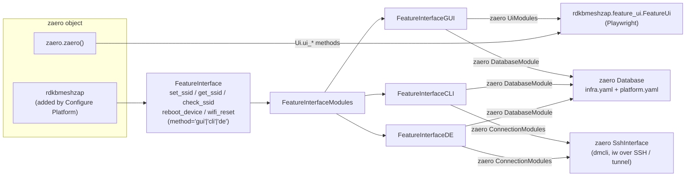
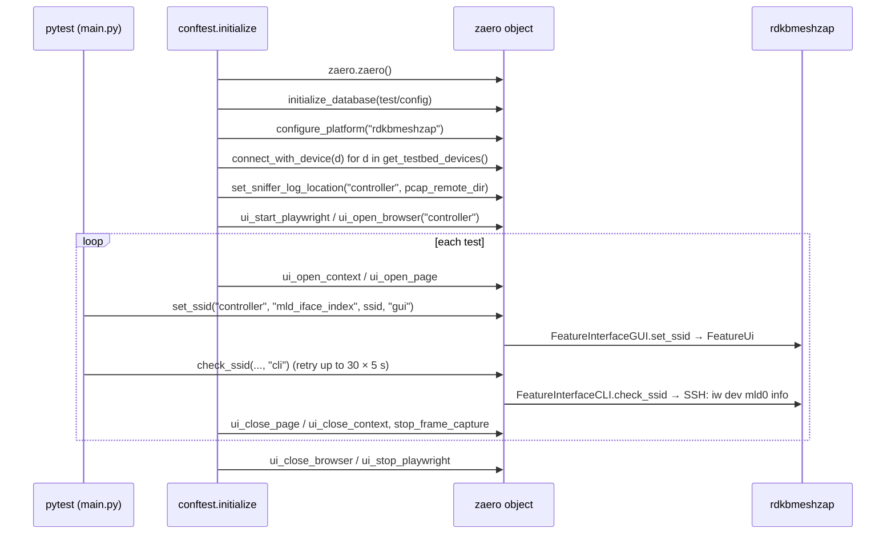

# EM-RDKB-ZaP integration

[EM-RDKB-ZaP](https://github.com/rdkcentral/EM-RDKB-ZaP) (`rdkbmeshzap`) is an
**external zaero platform plugin** for RDK-B EasyMesh nodes — a mesh
controller and its extenders. It adds the AP-side operations zaero does not
have (`set_ssid`, `get_ssid`, `check_ssid`, `reboot_device`, `wifi_reset`)
and ships a pytest suite that drives the whole testbed through one `zaero`
object.

This page describes how the two work together, checked against the
current zaero code in this repository.

## Repository layout

```
EM-RDKB-ZaP/
├── rdkbmeshzap/
│   ├── __init__.py                   class rdkbmeshzap(FeatureInterface)
│   ├── feature_interface.py          FeatureInterface — picks a backend per call
│   ├── feature_interface_modules.py  singleton factory {'gui', 'cli', 'de'}
│   ├── feature_interface_cli.py      dmcli Device.WiFi.SSID.* ; iw dev <if> info ; reboot
│   ├── feature_interface_de.py       dmcli Device.WiFi.DataElements.Network.SSID.*
│   ├── feature_interface_gui.py      controller web GUI through FeatureUi
│   └── feature_ui.py                 FeatureUi — Playwright (headless Chromium)
├── test/
│   ├── conftest.py                   session fixture + pytest-html hooks
│   ├── config/platform.yaml          RDK-B fields (merged with infra.yaml)
│   └── ref_test/*.py                 5 reference tests
├── main.py                           runs pytest with an HTML report
└── pyproject.toml                    package "rdkbmeshzap" 1.0.0
```

## How the plugin is put together



Each plugin method takes a `method` argument that chooses how the
operation is done:

| Method | `gui` | `cli` | `de` |
|---|---|---|---|
| `set_ssid` | Controller web GUI → *Wireless Settings* → *Fronthaul* profile (`index` not used) | `dmcli eRT setv Device.WiFi.SSID.{n}.SSID` | `dmcli eRT setv Device.WiFi.DataElements.Network.SSID.{n}.SSID` |
| `get_ssid` | `NotImplementedError` | `dmcli eRT getv Device.WiFi.SSID.{n}.SSID` | `dmcli eRT getv …DataElements.Network.SSID.{n}.SSID` |
| `check_ssid` | `NotImplementedError` | `iw dev <wifi_ifname or mld_ifname><n> info` | same as `cli` |
| `reboot_device` | — (not implemented) | `reboot` in the background | — |
| `wifi_reset` | GUI *System Settings* → `#reset-btn`, accepts dialogs | — | — |

`index` is the **name of a config field**, not a number: e.g.
`check_ssid("controller", "mld_iface_index", ssid, "cli")` reads
`mld_iface_index: 0` and `mld_ifname: 'mld'` from the controller entry and
checks `iw dev mld0 info`.

## Integration points with zaero

### 1. Configuration — `Initialize Database` merge

`test/config/` holds two files that both describe `controller`,
`extender1`, …:

- `infra.yaml` — copied from zaero with `python -m zaero init_config`:
  connection details (`login_ip`, credentials, `ssh_tunnel`,
  `tunnel_device`, `pcap_remote_dir`, …).
- `platform.yaml` — from the plugin: `ui_port`, `ui_home_page_title`,
  `wifi_ifname`, `mld_ifname`, `*_iface_index`, `*_ssid_index`,
  `default_ssid`, `backhaul_capture_iface`, `filter_1905`, channel /
  bandwidth / security values, …

`Initialize Database` loads both (name order: `infra.yaml`, then
`platform.yaml`) and merges each device's fields, so the plugin reads
`ui_port` and `login_ip` from the same `controller` entry.

### 2. Loading — `Configure Platform`

```python
platform = zaero_obj.read_from_database("controller", "platform")   # 'rdkbmeshzap'
zaero_obj.configure_platform(platform)                               # external=True
```

- `configure_platform` is a classmethod called through the `zaero`
  object, so the class `rdkbmeshzap` is added **first in the bases of the
  `zaero` class**. From then on `zaero_obj.set_ssid(...)` resolves to the
  plugin.
- `rdkbmeshzap.__init__` is not run. `FeatureInterface` methods use what
  the `zaero` object already has: `self.db_obj` and
  `self.get_ui_module_object()`. The backends create their own
  `DatabaseModule` / `ConnectionModules` / `UiModules` state.
- It works because `rdkbmeshzap` and its bases are plain classes. Basing
  the plugin on `zaero.base.BaseFeatureInterface` (an `abc.ABC`) would make
  this call fail with `TypeError: … object layout differs …`.

### 3. Transport — `ConnectionModules` / `SshInterface`

The `cli` and `de` backends get the device's connection object from
zaero (`connection: 'ssh'`) and run `dmcli` / `iw` on the node.
Extenders are reached through the controller (`extender1: ssh_tunnel:
True, tunnel_device: controller`), so the controller must be connected
first. `conftest.py` connects every device in `get_testbed_devices()`
order, i.e. file order — keep `controller` first in `infra.yaml`.

### 4. Web GUI — `UiModules` / `FeatureUi`

zaero's `Ui.ui_*` methods call `get_ui_module_object(platform)`, which
imports `rdkbmeshzap.feature_ui` and creates one cached `FeatureUi`.
`conftest.py` starts Playwright and opens the browser, context and page
through zaero; `FeatureInterfaceGUI` gets **the same cached object** from
`UiModules` and drives the page that is already open. `FeatureUi` reads
`login_ip`, `ui_port` and `ui_home_page_title` from the database and opens
`http://<login_ip>:<ui_port>/`.

`FeatureUi` also has methods zaero's `Ui` does not wrap
(`ui_set_dialog_handler`, `ui_wifi_reset_dialog_handler`,
`ui_click_button`); the GUI backend calls them directly.

### 5. Test results — `zi_logger` error log

Tests retry with `zi_logger.print_step(...)` / `print_error(...,
log_error=False)` and report with `print_success(...)`. `conftest.py`
clears the error log before each test and, in `pytest_runtest_makereport`,
marks the test failed if `zi_logger.get_error_logs()` is not empty — so a
`print_error(msg)` (default `log_error=True`) fails the test without an
exception.

## Test run sequence



Reference tests (`test/ref_test/`):

| Test | What it does |
|---|---|
| `test_ssid_config.py` | Set a random SSID via GUI; verify via `de` (`get_ssid`) and `cli` (`check_ssid`). |
| `test_plugin_arch.py` | Same, then checks the SSID is visible from `controller_wlan_client_1` (zaero `Check Ap Ssid Visibility`, `linux` platform). |
| `test_tunneling.py` | Set SSID via GUI; verify on the controller and on `extender1` (through the SSH tunnel). |
| `test_tunneling_and_reboot.py` | Set SSID, Wi-Fi reset via GUI, reboot extender and controller via CLI, reconnect, verify `default_ssid` on both. |
| `test_ssid_config_packet_capture.py` | Capture 1905 frames (`filter_1905`) on `backhaul_capture_iface` while changing the SSID, then download and delete the capture. |


